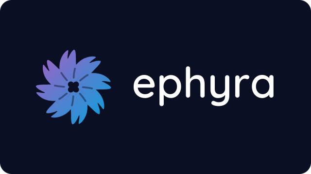

<h1 align="center">Ephyra</h1>
<h3 align="center">A de-Googled Jellyfin client for the NVIDIA Shield TV</h3>

---

<p align="center">

<br/><br/>
<a href="LICENSE">

</a>
<a href="https://github.com/miracle091/ephyra/releases">

</a>
</p>

Ephyra is a client for [Jellyfin](https://jellyfin.org) media servers, made for Android TV. It is a fork of the official
[Jellyfin for Android TV](https://github.com/jellyfin/jellyfin-androidtv) app, trimmed and tuned for the
**NVIDIA Shield TV**: every model from 2015 to the 2019 Pro. It needs no Google services, so it runs both on the stock Shield software and on
GMS-free AOSP or LineageOS builds.

The name comes from the ephyra, the small, light, young stage of a jellyfish.

## What is different

- **No Google services:** no Play Services, Firebase, Play Core or Cast SDK. A build check fails if one ever slips in
  through a dependency.
- **Built for the Shield:** Android 11 or later, ARM only (64-bit, and 32-bit for the 2019 non-Pro), so the APK
  carries only the code a Shield runs.
- **Tuned for its hardware (in progress):** hardware decoders first, sensible memory limits, refresh-rate switching on
  by default.
- **Its own identity:** the app is called Ephyra and installs next to the official Jellyfin app instead of replacing
  it.

The full list of changes, with their status, is in [FORK.md](FORK.md).

## Status

Ephyra is in early development. The plan goes phase by phase: dependencies and Google removal (done), build
retargeting (done), then playback, memory, interface, updates and releases. The first releases are out; expect rough
edges.

## Installing

Ephyra is installed by sideloading only: it is not on Google Play, F-Droid or any other store.

1. Download the APK from [Releases](https://github.com/miracle091/ephyra/releases), or add this repository to
   [Obtainium](https://github.com/ImranR98/Obtainium) to get updates.
2. Install it on the Shield with a file manager or over ADB: `adb install ephyra-v<version>.apk`. After that, the app checks for new releases by itself (Settings → About).

You need a Jellyfin server. If yours is too old, the app tells you which version it needs.

## Building

The app uses Gradle and needs JDK 21 and the Android SDK. Android Studio includes both. From the command line:

```shell
./gradlew assembleDebug
```

The APK ends up in `app/build/outputs/apk/debug/`. Debug builds use their own app id (`com.ephyra.app.debug`), so they
install next to a release build. The full check that CI runs is:

```shell
./gradlew assembleDebug detekt lint test
```

## Translations

The interface keeps every language of the official app; those translations come from Jellyfin's
[Weblate](https://translate.jellyfin.org/projects/jellyfin-android/jellyfin-androidtv), so improve them there. The few
texts that exist only in Ephyra are in English and Italian (`strings_ephyra.xml`); other languages show them in English.

## Upstream and support

Ephyra is a fork of [jellyfin/jellyfin-androidtv](https://github.com/jellyfin/jellyfin-androidtv), the official Jellyfin
for Android TV app, and keeps its history. Changes from that project are picked one by one when they help the Shield,
not merged wholesale. Report problems with Ephyra in [this repository's issues](https://github.com/miracle091/ephyra/issues),
not to the Jellyfin project, which does not support this fork.

## License and trademarks

Ephyra comes from [Jellyfin for Android TV](https://github.com/jellyfin/jellyfin-androidtv), which is distributed under
the [GPL-2.0](LICENSE). Ephyra's own changes are licensed under the GPL-2.0 or, at your option, any later version; see
[FORK.md](FORK.md#license) for details. It is not affiliated with or endorsed by
the Jellyfin project or NVIDIA. The Jellyfin name and logo belong to the Jellyfin project; "SHIELD" is a trademark of NVIDIA
Corporation, used here only to name the device Ephyra targets.
